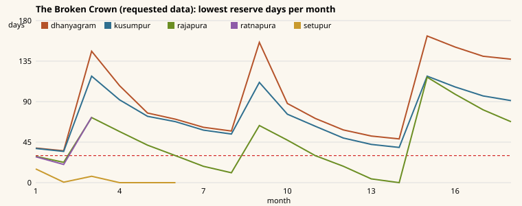
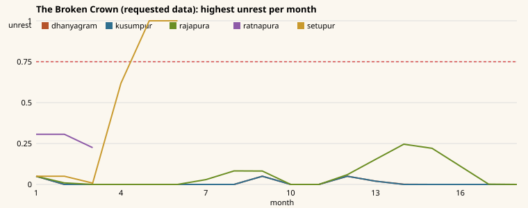
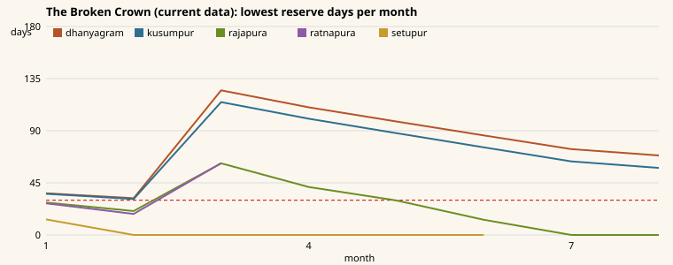

# SIM-01 campaign report (540 days)

Generated by `node scripts/sim/campaign-report.mjs` (headless, the real simulation; every player event answered with its first - safe default - choice, every engagement autoresolved, no other player input). Raw data: `campaign-report.json`.

Requested data (the Creative Director's call, see "Data requests" below): CD-1 `RULES.population.laborHealthWeight` 0.5 -> 0; CD-2 `RULES.distribution.exportAboveDays` 120 -> 75.

## Outcomes

| Run | Outcome | Day | Score | Player settlements at the end | Battles | Revolts | Secessions | Real seconds |
|---|---|---|---|---|---|---|---|---|
| The Broken Crown - current data | defeat (out_fallen) | 252 | 612 | dhanyagram, kusumpur | 15 | 13 | 12 | 2.1 |
| The Broken Crown - requested data (CD-1, CD-2) | ended (out_restored) | 540 | 1471 | rajapura, dhanyagram, kusumpur | 9 | 12 | 11 | 1.6 |
| The Seven Hills - requested data | defeat (out_sh_fallen) | 215 | 182 | kandaravasa | 8 | 7 | 3 | 1.4 |
| Sandbox (River of Kings) - requested data | ongoing (-) | 540 | 1189 | rajapura, dhanyagram, kusumpur, ratnapura, setupur | 3 | 8 | 8 | 0.9 |

## DESIGN_SPEC §13.2 grain calibration (annual civilian balance, measured with the daily economy)

| Realm | Target (normal) | Current data, M = 1 | Requested data, M = 1 | Current data, M = 0.7 | Requested data, M = 0.7 |
|---|---|---|---|---|---|
| heartland | +15% | -0.0% | +15.2% | -20.5% | -3.6% |
| highland | -9% | -33.0% | -10.8% | -44.9% | -25.9% |
| forest | +3% | -20.7% | +2.1% | -36.5% | -15.6% |
| frontier | -8% | -31.5% | -10.2% | -42.8% | -23.7% |

## Data requests (Creative Director, `src/data/**`)

1. **CD-1** `RULES.population.laborHealthWeight` 0.5 -> **0**: the §13.2 bands were calibrated with labor = population x 0.45; health-weighted labor removes 10-18% of farm labor (calibration table, "current data" columns).
2. **CD-2** `RULES.distribution.exportAboveDays` 120 -> **75**: grain villages hover at 40-170 reserve days, so at 120 they rarely export and Rajapura (break-even on its own fields) starves every lean season - The Broken Crown loses the capital with the current data and ends `out_restored` with CD-1 + CD-2 (Outcomes). Auto-resolved survival over seeds 1-10 with CD-1: 120 days -> 1/10, 90 -> 9/10, 75 -> 10/10, 60 -> 10/10; at 90 the result moves with tactical battle outcomes (a capital that empties days before the second rabi harvest revolts - CD-3), 75 leaves a margin.
3. **CD-3** Deficit realms (Giridurga -9%, Marudesha -8% by design) revolt every lean season under the flat +0.02/day starvation unrest unless their AI buys or rations grain; consider scaling that term by the unmet share of need (0.02 x deficit share) or raising their fertility. Until SIM-02 manages grain, most AI settlements secede within the first year (Incidents).
4. **CD-4** Landmark rules are keyed by landmark id in code (Royal Granary spoilage x0.5, Cliff Cistern besieged consumption x0.6, Elephant Grove elephant recruit time x0.7, Great Road royal-road speed); please add `LandmarkDef` fields (`spoilageFactor`, `besiegedConsumption`, `recruitTime: { war_elephants: 0.7 }`, `roadSpeed`).
5. **CD-5** negotiate_rebels autonomy: `offers.autonomy.taxShare` -0.25 disagrees with the §7.5 tax formula (1 - 0.5 x autonomy, so +0.25 autonomy = -12.5% tax); the sim uses the formula - please pick one.
6. **CD-6** Constants still in code, please move them to RULES: road repair 20 wealth per km per missing condition point (`commands.ROAD_REPAIR_WEALTH_PER_KM`); governor loyalty drifts 10%/month toward 0.5 + 0.15 (interest met) or - 0.1 (not met) - 0.2 x province unrest + 0.2 x (legitimacy - 0.5) (`politics.governorLoyaltyTarget`).
7. **CD-7** Restate the DESIGN_SPEC worked examples with the real map and modifiers: Rajapura -> Giridurg is 114 km of road (4.3 days; the example assumed 81 km), 9.2 days across country (terrain + the river crossing); the Royal Host eats 195 grain/day and carries 23.5 days (27 with Suvarna supplyEfficiency 1.15); Giridurg (4,200 wall HP) falls in 52.5 days to one engineer formation at siegeStrength 1 (48 for Suvarna, 1.1); the Palace takes 144 days at constructionSpeed 1 (131 for Suvarna).

## The Broken Crown - current data

### Monthly ledger (player)

| Month | Date | Tax | Trade | Tribute | Army | Buildings | Admin | Net | Treasury | Royal reserve | Stability | Legitimacy | Settlements | Soldiers |
|---|---|---|---|---|---|---|---|---|---|---|---|---|---|---|
| 1 | -300/7 | 957 | 325 | 0 | 599 | 84 | 26 | 573 | 4,313 | 0 | 0.58 | 0.80 | 5 | 1,492 |
| 2 | -300/8 | 1,081 | 329 | 0 | 556 | 84 | 26 | 744 | 5,297 | 19,712 | 0.59 | 0.80 | 5 | 1,377 |
| 3 | -300/9 | 970 | 159 | 0 | 511 | 72 | 21 | 526 | 5,955 | 18,903 | 0.59 | 0.72 | 4 | 1,271 |
| 4 | -300/10 | 883 | 159 | 0 | 440 | 72 | 21 | 509 | 6,784 | 18,115 | 0.59 | 0.69 | 4 | 1,102 |
| 5 | -300/11 | 778 | 157 | 0 | 397 | 72 | 21 | 445 | 7,349 | 0 | 0.59 | 0.69 | 4 | 988 |
| 6 | -300/12 | 686 | 157 | 0 | 354 | 63 | 16 | 410 | 7,880 | 0 | 0.61 | 0.69 | 3 | 856 |
| 7 | -299/1 | 513 | 142 | 0 | 142 | 63 | 16 | 435 | 8,435 | 0 | 0.61 | 0.69 | 3 | 364 |
| 8 | -299/2 | 145 | 12 | 0 | 81 | 63 | 16 | -2 | 8,491 | 6,520 | 0.61 | 0.69 | 3 | 209 |

### Lowest reserve days in the month / highest unrest / worst stage

| Month | dhanyagram | kusumpur | rajapura | ratnapura | setupur |
|---|---|---|---|---|---|
| 1 | 36 d / 0.05 | 36 d / 0.05 | 28 d / 0.05 | 27 d / 0.31 | 13 d / 0.05 |
| 2 | 32 d / 0.00 | 31 d / 0.00 | 21 d / 0.01 | 18 d / 0.31 protest | 0 d / 0.10 |
| 3 | 125 d / 0.00 | 115 d / 0.00 | 62 d / 0.00 | 62 d / 0.23 grumbling | 0 d / 0.09 |
| 4 | 110 d / 0.00 | 100 d / 0.00 | 41 d / 0.00 | - | 0 d / 0.72 revolt |
| 5 | 98 d / 0.00 | 88 d / 0.00 | 30 d / 0.00 | - | 0 d / 1.00 secession |
| 6 | 86 d / 0.00 | 76 d / 0.00 | 13 d / 0.04 | - | 0 d / 1.00 secession |
| 7 | 74 d / 0.00 | 64 d / 0.00 | 0 d / 0.36 protest | - | - |
| 8 | 69 d / 0.00 | 58 d / 0.00 | 0 d / 0.92 secession | - | - |

### Battles (15)

- day 9: The Battle of the Setu Bridge: Giridurga defeated Suvarna; 197 fell.
- day 163: The Battle of Sangam of the Two Rivers: Suvarna defeated Giridurga; 28 fell.
- day 166: The Battle of Sangam of the Two Rivers: Suvarna defeated Nilavana; 41 fell.
- day 178: The Battle of Ratnapura: The rebels of Ratnapura defeated Nilavana; 23 fell.
- day 182: The Battle of the White Flats: The rebels of Lavanapura defeated Marudesha; 4 fell.
- day 184: The Battle of Sangam of the Two Rivers: neither Giridurga nor Suvarna could claim the field; 0 fell.
- day 192: The Battle of the Dvara Pass: The rebels of Dvaradurga defeated Giridurga; 12 fell.
- day 192: The Battle of Ratnapura: neither Nilavana nor Suvarna could claim the field; 0 fell.
- day 196: The Battle of Ushtragram: The rebels of Ushtragram defeated Marudesha; 1 fell.
- day 198: The Battle of Pashanagram: The rebels of Pashanagram defeated Giridurga; 11 fell.
- day 205: The Battle of Ratnapura: neither Nilavana nor Suvarna could claim the field; 0 fell.
- day 207: The Battle of Sangam of the Two Rivers: neither Giridurga nor Suvarna could claim the field; 0 fell.
- day 212: The Battle of Ratnapura: neither Nilavana nor Suvarna could claim the field; 0 fell.
- day 217: The Battle of Kandaravasa: The rebels of Kandaravasa defeated Giridurga; 1 fell.
- day 222: The Battle of Sangam of the Two Rivers: The rebels of Rajapura defeated Suvarna; 26 fell.

### Incidents

- day 63 - capture: Ratnapura: heartland -> forest
- day 63 - war: forest declared war on heartland
- day 119 - revolt: Setupur: 64 rebels
- day 127 - revolt: Setupur: 63 rebels
- day 157 - secession: Setupur left heartland
- day 161 - revolt: Ratnapura: 212 rebels
- day 182 - revolt: Lavanapura: 130 rebels
- day 191 - secession: Ratnapura left forest
- day 192 - revolt: Dvaradurga: 71 rebels
- day 195 - revolt: Shilapur: 166 rebels
- day 196 - revolt: Ushtragram: 39 rebels
- day 196 - capture: Ushtragram: frontier -> rebels
- day 198 - revolt: Pashanagram: 48 rebels
- day 198 - capture: Pashanagram: highland -> rebels
- day 199 - revolt: Giridurg: 177 rebels
- day 211 - revolt: Nilavanapura: 282 rebels
- day 212 - revolt: Gajavana: 44 rebels
- day 212 - secession: Lavanapura left frontier
- day 213 - revolt: Kandaravasa: 54 rebels
- day 217 - capture: Kandaravasa: highland -> rebels
- day 222 - secession: Dvaradurga left highland
- day 222 - revolt: Rajapura: 714 rebels
- day 225 - secession: Shilapur left highland
- day 226 - secession: Ushtragram left rebels
- day 228 - secession: Pashanagram left rebels
- day 229 - secession: Giridurg left highland
- day 241 - secession: Nilavanapura left forest
- day 242 - secession: Gajavana left forest
- day 243 - secession: Kandaravasa left rebels
- day 252 - secession: Rajapura left heartland

### Player events (23, first choice taken)

- day 1: The Broken Crown -> Take up the regency
- day 3: Whispers in the Hall of Pillars -> Proclaim Kumara Aditya heir before the court
- day 14: The Council of War -> Grain first: fill the granaries before the hot season
- day 23: The Prince's Letters -> Watch and wait
- day 31: Protest in Ratnapura -> Hear their grievances
- day 32: Envoys from the Seven Peaks -> Send them home: the bridge is ours
- day 46: A Thin Harvest -> Trust the winter crop
- day 52: Raiders at the Setu Bridge -> Repair what we can
- day 61: The Governor's Ultimatum -> Negotiate lower taxes
- day 63: The Gates of Ratnapura -> Let him go - and march
- day 98: Protest in Setupur -> Hear their grievances
- day 99: Pilgrims on the Road -> Welcome them
- day 108: Tax Refusal in Setupur -> Negotiate a lower rate
- day 115: Riots in Setupur -> Let it burn out
- day 119: Revolt in Setupur -> Negotiate with the rebel leaders
- day 120: The Grain and the Sword -> Count the granaries
- day 136: Bandits on the Road -> Let the villages deal with it
- day 138: Grain for the Host -> The host will live off the land
- day 145: Protest in Setupur -> Hear their grievances
- day 179: Raiders at the Setu Bridge -> Repair what we can
- day 180: The Temple Town Seeks a Protector -> Leave the sacred town free
- day 230: Tax Refusal in Rajapura -> Negotiate a lower rate
- day 245: The Lean Months -> Hold the royal reserve for the army

### Statistics

`grain_harvested` 764555 · `events_resolved` 23 · `battles_fought` 9 · `enemies_killed` 118 · `soldiers_lost` 1443 · `formations_routed` 52 · `largest_battle` 1273 · `wealth_earned` 8605 · `trade_income` 1442 · `famine_days` 104 · `grain_spoiled` 10278 · `wars` 1 · `revolts` 3 · `settlements_lost_to_rebels` 2 · `battles_won` 2

## The Broken Crown - requested data (CD-1, CD-2)

### Monthly ledger (player)

| Month | Date | Tax | Trade | Tribute | Army | Buildings | Admin | Net | Treasury | Royal reserve | Stability | Legitimacy | Settlements | Soldiers |
|---|---|---|---|---|---|---|---|---|---|---|---|---|---|---|
| 1 | -300/7 | 966 | 327 | 0 | 599 | 84 | 26 | 584 | 4,324 | 0 | 0.58 | 0.80 | 5 | 1,492 |
| 2 | -300/8 | 1,088 | 331 | 0 | 568 | 84 | 26 | 741 | 5,305 | 22,111 | 0.63 | 0.80 | 5 | 1,410 |
| 3 | -300/9 | 977 | 160 | 0 | 523 | 72 | 21 | 521 | 5,958 | 21,430 | 0.63 | 0.72 | 4 | 1,304 |
| 4 | -300/10 | 942 | 159 | 0 | 447 | 72 | 21 | 562 | 6,640 | 20,542 | 0.63 | 0.72 | 4 | 1,127 |
| 5 | -300/11 | 871 | 158 | 0 | 412 | 72 | 21 | 524 | 7,284 | 20,184 | 0.63 | 0.69 | 4 | 1,037 |
| 6 | -300/12 | 775 | 158 | 0 | 381 | 63 | 16 | 474 | 7,878 | 4,861 | 0.64 | 0.69 | 3 | 934 |
| 7 | -299/1 | 698 | 158 | 0 | 365 | 63 | 16 | 413 | 8,411 | 0 | 0.64 | 0.69 | 3 | 886 |
| 8 | -299/2 | 853 | 158 | 0 | 278 | 63 | 16 | 654 | 9,186 | 22,625 | 0.64 | 0.69 | 3 | 677 |
| 9 | -299/3 | 917 | 158 | 0 | 278 | 63 | 16 | 720 | 10,025 | 22,625 | 0.64 | 0.67 | 3 | 674 |
| 10 | -299/4 | 901 | 158 | 0 | 278 | 63 | 16 | 703 | 10,548 | 22,625 | 0.63 | 0.67 | 3 | 674 |
| 11 | -299/5 | 796 | 158 | 0 | 278 | 63 | 16 | 598 | 11,267 | 22,625 | 0.62 | 0.67 | 3 | 674 |
| 12 | -299/6 | 713 | 158 | 0 | 276 | 63 | 16 | 517 | 11,904 | 0 | 0.64 | 0.67 | 3 | 667 |
| 13 | -299/7 | 583 | 158 | 0 | 155 | 63 | 16 | 508 | 12,532 | 0 | 0.63 | 0.67 | 3 | 380 |
| 14 | -299/8 | 771 | 158 | 0 | 100 | 63 | 16 | 750 | 13,402 | 33,040 | 0.62 | 0.72 | 3 | 244 |
| 15 | -299/9 | 853 | 158 | 0 | 100 | 63 | 16 | 832 | 14,354 | 33,040 | 0.62 | 0.72 | 3 | 244 |
| 16 | -299/10 | 934 | 158 | 0 | 100 | 63 | 16 | 913 | 15,587 | 33,040 | 0.62 | 0.70 | 3 | 244 |
| 17 | -299/11 | 947 | 159 | 0 | 100 | 63 | 16 | 926 | 16,633 | 33,040 | 0.61 | 0.70 | 3 | 244 |
| 18 | -299/12 | 954 | 159 | 0 | 100 | 63 | 16 | 934 | 17,687 | 33,040 | 0.61 | 0.70 | 3 | 244 |

### Lowest reserve days in the month / highest unrest / worst stage

| Month | dhanyagram | kusumpur | rajapura | ratnapura | setupur |
|---|---|---|---|---|---|
| 1 | 38 d / 0.05 | 38 d / 0.05 | 29 d / 0.05 | 29 d / 0.31 | 15 d / 0.05 |
| 2 | 35 d / 0.00 | 35 d / 0.00 | 23 d / 0.01 | 20 d / 0.31 protest | 0 d / 0.05 |
| 3 | 146 d / 0.00 | 118 d / 0.00 | 72 d / 0.00 | 73 d / 0.22 grumbling | 6 d / 0.01 |
| 4 | 108 d / 0.00 | 92 d / 0.00 | 57 d / 0.00 | - | 0 d / 0.62 unrest |
| 5 | 77 d / 0.00 | 74 d / 0.00 | 42 d / 0.00 | - | 0 d / 1.00 secession |
| 6 | 68 d / 0.00 | 64 d / 0.00 | 30 d / 0.00 | - | 0 d / 1.00 secession |
| 7 | 59 d / 0.00 | 55 d / 0.00 | 16 d / 0.03 | - | - |
| 8 | 55 d / 0.00 | 51 d / 0.00 | 9 d / 0.08 | - | - |
| 9 | 156 d / 0.05 | 111 d / 0.05 | 63 d / 0.08 | - | - |
| 10 | 93 d / 0.00 | 79 d / 0.00 | 50 d / 0.00 | - | - |
| 11 | 58 d / 0.00 | 65 d / 0.00 | 30 d / 0.00 | - | - |
| 12 | 45 d / 0.05 | 52 d / 0.05 | 21 d / 0.06 | - | - |
| 13 | 39 d / 0.02 | 45 d / 0.02 | 7 d / 0.15 grumbling | - | - |
| 14 | 36 d / 0.00 | 41 d / 0.00 | 0 d / 0.25 grumbling | - | - |
| 15 | 163 d / 0.00 | 118 d / 0.00 | 117 d / 0.22 grumbling | - | - |
| 16 | 151 d / 0.00 | 106 d / 0.00 | 98 d / 0.11 grumbling | - | - |
| 17 | 140 d / 0.00 | 96 d / 0.00 | 81 d / 0.00 | - | - |
| 18 | 130 d / 0.00 | 87 d / 0.00 | 64 d / 0.00 | - | - |

### Battles (9)

- day 9: The Battle of the Setu Bridge: Giridurga defeated Suvarna; 197 fell.
- day 169: The Battle of Sangam of the Two Rivers: Suvarna defeated Giridurga; 22 fell.
- day 194: The Battle of the White Flats: The rebels of Lavanapura defeated Marudesha; 3 fell.
- day 207: The Battle of the Dvara Pass: The rebels of Dvaradurga defeated Giridurga; 12 fell.
- day 208: The Battle of Ushtragram: The rebels of Ushtragram defeated Marudesha; 1 fell.
- day 214: The Battle of Pashanagram: The rebels of Pashanagram defeated Giridurga; 9 fell.
- day 220: The Battle of Sangam of the Two Rivers: neither Giridurga nor Suvarna could claim the field; 0 fell.
- day 241: The Battle of Kandaravasa: The rebels of Kandaravasa defeated Giridurga; 22 fell.
- day 352: The Battle of the Nilavana: The rebels of Nilavanapura defeated Nilavana; 2 fell.

### Incidents

- day 63 - capture: Ratnapura: heartland -> forest
- day 63 - war: forest declared war on heartland
- day 126 - revolt: Setupur: 64 rebels
- day 133 - revolt: Setupur: 64 rebels
- day 163 - secession: Setupur left heartland
- day 180 - revolt: Ratnapura: 212 rebels
- day 194 - revolt: Lavanapura: 130 rebels
- day 207 - revolt: Dvaradurga: 71 rebels
- day 208 - revolt: Ushtragram: 40 rebels
- day 208 - capture: Ushtragram: frontier -> rebels
- day 210 - secession: Ratnapura left forest
- day 210 - revolt: Shilapur: 166 rebels
- day 214 - revolt: Pashanagram: 48 rebels
- day 214 - capture: Pashanagram: highland -> rebels
- day 216 - revolt: Giridurg: 178 rebels
- day 224 - secession: Lavanapura left frontier
- day 237 - secession: Dvaradurga left highland
- day 238 - secession: Ushtragram left rebels
- day 240 - secession: Shilapur left highland
- day 241 - revolt: Kandaravasa: 54 rebels
- day 241 - succession: highland: Kumari Meghavati
- day 241 - capture: Kandaravasa: highland -> rebels
- day 244 - secession: Pashanagram left rebels
- day 246 - secession: Giridurg left highland
- day 271 - secession: Kandaravasa left rebels
- day 301 - monsoon: M = 1.12 (normal)
- day 350 - revolt: Gajavana: 44 rebels
- day 352 - revolt: Nilavanapura: 284 rebels
- day 380 - secession: Gajavana left forest
- day 382 - secession: Nilavanapura left forest

### Player events (35, first choice taken)

- day 1: The Broken Crown -> Take up the regency
- day 3: Whispers in the Hall of Pillars -> Proclaim Kumara Aditya heir before the court
- day 14: The Council of War -> Grain first: fill the granaries before the hot season
- day 23: The Prince's Letters -> Watch and wait
- day 31: Protest in Ratnapura -> Hear their grievances
- day 32: Envoys from the Seven Peaks -> Send them home: the bridge is ours
- day 46: A Thin Harvest -> Trust the winter crop
- day 52: Raiders at the Setu Bridge -> Repair what we can
- day 61: The Governor's Ultimatum -> Negotiate lower taxes
- day 63: The Gates of Ratnapura -> Let him go - and march
- day 107: Protest in Setupur -> Hear their grievances
- day 114: Raiders at the Setu Bridge -> Repair what we can
- day 117: Riots in Setupur -> Let it burn out
- day 120: The Grain and the Sword -> Count the granaries
- day 120: Tax Refusal in Setupur -> Negotiate a lower rate
- day 122: Bandits on the Road -> Let the villages deal with it
- day 128: Revolt in Setupur -> Negotiate with the rebel leaders
- day 138: Grain for the Host -> The host will live off the land
- day 153: Protest in Setupur -> Hear their grievances
- day 180: The Temple Town Seeks a Protector -> Leave the sacred town free
- day 225: Raiders at the Setu Bridge -> Repair what we can
- day 245: The Lean Months -> Hold the royal reserve for the army
- day 274: The Salt Caravan -> Buy salt for the granaries
- day 300: The Monsoon Comes -> Wait for the rains
- day 315: The River Rises -> Endure it
- day 326: Fever in the Lanes -> Endure it
- day 330: The Guild Charter of Naukapattana -> Decline politely
- day 340: Raiders at the Setu Bridge -> Repair what we can
- day 345: The Rains Fail -> Pray for rain
- day 430: The Last Envoy -> Refuse: the war ends on our terms
- day 442: Raiders at the Setu Bridge -> Repair what we can
- day 464: Pilgrims on the Road -> Welcome them
- day 473: The Regent Is Unwell -> Let her rest; the council keeps the seal
- day 510: Raiders at the Setu Bridge -> Repair what we can
- day 515: The Year Turns -> Let them write

### Statistics

`grain_harvested` 1965001 · `events_resolved` 35 · `battles_fought` 3 · `enemies_killed` 71 · `soldiers_lost` 1406 · `formations_routed` 19 · `largest_battle` 1123 · `wealth_earned` 21146 · `trade_income` 3194 · `grain_spoiled` 62578 · `wars` 1 · `famine_days` 67 · `revolts` 2 · `settlements_lost_to_rebels` 1 · `battles_won` 1

## The Seven Hills - requested data

### Monthly ledger (player)

| Month | Date | Tax | Trade | Tribute | Army | Buildings | Admin | Net | Treasury | Royal reserve | Stability | Legitimacy | Settlements | Soldiers |
|---|---|---|---|---|---|---|---|---|---|---|---|---|---|---|
| 1 | -300/7 | 302 | 52 | 0 | 296 | 66 | 16 | -24 | 2,986 | 0 | 0.57 | 0.61 | 5 | 883 |
| 2 | -300/8 | 345 | 52 | 0 | 262 | 66 | 16 | 54 | 3,520 | 2,452 | 0.57 | 0.62 | 5 | 758 |
| 3 | -300/9 | 335 | 52 | 0 | 262 | 66 | 16 | 44 | 3,743 | 0 | 0.62 | 0.63 | 5 | 758 |
| 4 | -300/10 | 281 | 52 | 0 | 236 | 66 | 16 | 16 | 4,240 | 0 | 0.62 | 0.64 | 5 | 660 |
| 5 | -300/11 | 141 | 34 | 0 | 128 | 66 | 16 | -33 | 4,677 | 0 | 0.61 | 0.65 | 5 | 355 |
| 6 | -300/12 | 47 | 16 | 0 | 49 | 66 | 16 | -67 | 4,560 | 0 | 0.59 | 0.63 | 5 | 137 |
| 7 | -299/1 | 0 | 1 | 0 | 2 | 29 | 6 | -36 | 4,587 | 0 | 0.54 | 0.64 | 2 | 9 |

### Lowest reserve days in the month / highest unrest / worst stage

| Month | dvaradurga | giridurg | kandaravasa | pashanagram | shilapur |
|---|---|---|---|---|---|
| 1 | 23 d / 0.05 | 27 d / 0.05 | 31 d / 0.05 | 29 d / 0.05 | 17 d / 0.05 |
| 2 | 14 d / 0.06 | 18 d / 0.03 | 25 d / 0.02 | 22 d / 0.03 | 7 d / 0.04 |
| 3 | 35 d / 0.03 | 51 d / 0.00 | 65 d / 0.00 | 58 d / 0.01 | 26 d / 0.00 |
| 4 | 13 d / 0.05 | 30 d / 0.00 | 48 d / 0.00 | 39 d / 0.00 | 1 d / 0.06 |
| 5 | 0 d / 0.51 tax_refusal | 11 d / 0.06 | 33 d / 0.00 | 22 d / 0.03 | 0 d / 0.73 unrest |
| 6 | 0 d / 1.00 secession | 0 d / 0.58 tax_refusal | 19 d / 0.06 | 5 d / 0.17 grumbling | 0 d / 1.00 secession |
| 7 | 0 d / 1.00 secession | 0 d / 1.00 secession | 3 d / 0.50 tax_refusal | 0 d / 0.79 revolt | 0 d / 1.00 secession |

### Battles (8)

- day 10: The Battle of the Red Quarries: Suvarna defeated Giridurga; 357 fell.
- day 157: The Battle of the Dvara Pass: The rebels of Dvaradurga defeated Giridurga; 8 fell.
- day 189: The Battle of the White Flats: The rebels of Lavanapura defeated Marudesha; 4 fell.
- day 190: The Battle of Kandaravasa: neither Suvarna nor Giridurga could claim the field; 0 fell.
- day 205: The Battle of Pashanagram: The rebels of Pashanagram defeated Giridurga; 0 fell.
- day 207: The Battle of Kandaravasa: Suvarna defeated Giridurga; 3 fell.
- day 208: The Battle of Ushtragram: The rebels of Ushtragram defeated Marudesha; 1 fell.
- day 211: The Battle of Kandaravasa: Suvarna defeated Giridurga; 0 fell.

### Incidents

- day 151 - revolt: Shilapur: 163 rebels
- day 157 - revolt: Dvaradurga: 71 rebels
- day 158 - revolt: Shilapur: 161 rebels
- day 185 - revolt: Giridurg: 179 rebels
- day 187 - secession: Dvaradurga left highland
- day 188 - secession: Shilapur left highland
- day 189 - revolt: Lavanapura: 131 rebels
- day 205 - revolt: Pashanagram: 49 rebels
- day 205 - capture: Pashanagram: highland -> rebels
- day 208 - revolt: Ushtragram: 40 rebels
- day 208 - capture: Ushtragram: frontier -> rebels
- day 215 - secession: Giridurg left highland

### Player events (16, first choice taken)

- day 1: The Seven Hills -> Ring the assembly drum
- day 8: The Hungry Plateau -> Ration the clans
- day 25: Lowland Patrols -> Endure it
- day 28: A Letter from Ratnapura -> Burn the letter
- day 70: The Assembly of the Seven Clans -> Seek consensus
- day 116: Lowland Patrols -> Endure it
- day 129: Protest in Shilapur -> Hear their grievances
- day 140: The River Oath -> Look to the river
- day 140: Tax Refusal in Shilapur -> Negotiate a lower rate
- day 148: Riots in Shilapur -> Let it burn out
- day 153: Revolt in Shilapur -> Negotiate with the rebel leaders
- day 167: The Salt Caravan -> Buy salt for the granaries
- day 170: Riders of the Salt Road -> Decline the alliance
- day 177: Protest in Dvaradurga -> Hear their grievances
- day 180: Bandits on the Road -> Let the villages deal with it
- day 202: Lowland Patrols -> Endure it

### Statistics

`grain_harvested` 238250 · `events_resolved` 16 · `battles_fought` 6 · `enemies_killed` 96 · `soldiers_lost` 1119 · `formations_routed` 14 · `largest_battle` 1552 · `wealth_earned` 4415 · `trade_income` 260 · `grain_spoiled` 6315 · `famine_days` 180 · `revolts` 5 · `settlements_lost_to_rebels` 3

## Sandbox (River of Kings) - requested data

### Monthly ledger (player)

| Month | Date | Tax | Trade | Tribute | Army | Buildings | Admin | Net | Treasury | Royal reserve | Stability | Legitimacy | Settlements | Soldiers |
|---|---|---|---|---|---|---|---|---|---|---|---|---|---|---|
| 1 | -300/1 | 1,169 | 307 | 0 | 197 | 84 | 26 | 1,169 | 4,409 | 2,000 | 0.61 | 0.60 | 5 | 632 |
| 2 | -300/2 | 1,164 | 311 | 0 | 197 | 84 | 26 | 1,169 | 5,818 | 40,959 | 0.61 | 0.60 | 5 | 632 |
| 3 | -300/3 | 1,176 | 311 | 0 | 197 | 84 | 26 | 1,181 | 7,239 | 40,959 | 0.61 | 0.60 | 5 | 632 |
| 4 | -300/4 | 1,179 | 311 | 0 | 197 | 84 | 26 | 1,184 | 8,663 | 40,959 | 0.62 | 0.60 | 5 | 632 |
| 5 | -300/5 | 1,158 | 311 | 0 | 197 | 84 | 26 | 1,163 | 10,066 | 40,959 | 0.62 | 0.60 | 5 | 632 |
| 6 | -300/6 | 1,021 | 312 | 0 | 197 | 84 | 26 | 1,026 | 11,332 | 34,673 | 0.62 | 0.60 | 5 | 632 |
| 7 | -300/7 | 919 | 312 | 0 | 197 | 84 | 26 | 924 | 12,496 | 0 | 0.62 | 0.60 | 5 | 632 |
| 8 | -300/8 | 1,073 | 312 | 0 | 197 | 84 | 26 | 1,079 | 13,815 | 42,009 | 0.61 | 0.60 | 5 | 632 |
| 9 | -300/9 | 1,146 | 312 | 0 | 197 | 84 | 26 | 1,152 | 15,206 | 42,009 | 0.61 | 0.60 | 5 | 632 |
| 10 | -300/10 | 1,150 | 312 | 0 | 197 | 84 | 26 | 1,155 | 16,802 | 42,009 | 0.61 | 0.60 | 5 | 632 |
| 11 | -300/11 | 1,153 | 312 | 0 | 197 | 84 | 26 | 1,159 | 18,200 | 42,009 | 0.61 | 0.60 | 5 | 632 |
| 12 | -300/12 | 1,133 | 312 | 0 | 197 | 84 | 26 | 1,139 | 19,279 | 42,009 | 0.61 | 0.60 | 5 | 632 |
| 13 | -299/1 | 1,015 | 312 | 0 | 197 | 84 | 26 | 1,021 | 20,540 | 38,210 | 0.60 | 0.60 | 5 | 632 |
| 14 | -299/2 | 1,101 | 312 | 0 | 197 | 84 | 26 | 1,107 | 21,887 | 62,925 | 0.60 | 0.60 | 5 | 632 |
| 15 | -299/3 | 1,144 | 312 | 0 | 197 | 84 | 26 | 1,150 | 23,277 | 62,925 | 0.60 | 0.60 | 5 | 632 |
| 16 | -299/4 | 1,149 | 312 | 0 | 197 | 84 | 26 | 1,155 | 24,672 | 65,925 | 0.60 | 0.60 | 5 | 632 |
| 17 | -299/5 | 1,048 | 312 | 0 | 197 | 84 | 26 | 1,054 | 25,966 | 65,925 | 0.60 | 0.60 | 5 | 632 |
| 18 | -299/6 | 898 | 313 | 0 | 197 | 84 | 26 | 904 | 27,110 | 29,167 | 0.60 | 0.60 | 5 | 632 |

### Lowest reserve days in the month / highest unrest / worst stage

| Month | dhanyagram | kusumpur | rajapura | ratnapura | setupur |
|---|---|---|---|---|---|
| 1 | 66 d / 0.05 | 66 d / 0.05 | 58 d / 0.05 | 55 d / 0.05 | 57 d / 0.05 |
| 2 | 62 d / 0.00 | 61 d / 0.00 | 49 d / 0.00 | 45 d / 0.00 | 48 d / 0.00 |
| 3 | 153 d / 0.00 | 110 d / 0.00 | 107 d / 0.00 | 60 d / 0.00 | 60 d / 0.00 |
| 4 | 108 d / 0.00 | 83 d / 0.00 | 78 d / 0.00 | 60 d / 0.00 | 60 d / 0.00 |
| 5 | 76 d / 0.00 | 67 d / 0.00 | 57 d / 0.00 | 44 d / 0.00 | 45 d / 0.00 |
| 6 | 49 d / 0.00 | 54 d / 0.00 | 37 d / 0.00 | 30 d / 0.01 | 30 d / 0.01 |
| 7 | 25 d / 0.00 | 47 d / 0.00 | 30 d / 0.00 | 29 d / 0.04 | 29 d / 0.05 |
| 8 | 27 d / 0.16 grumbling | 44 d / 0.00 | 23 d / 0.01 | 21 d / 0.07 | 22 d / 0.08 |
| 9 | 162 d / 0.14 grumbling | 118 d / 0.00 | 118 d / 0.00 | 60 d / 0.05 | 61 d / 0.06 |
| 10 | 134 d / 0.08 | 99 d / 0.00 | 93 d / 0.00 | 60 d / 0.00 | 60 d / 0.00 |
| 11 | 94 d / 0.00 | 79 d / 0.00 | 72 d / 0.00 | 58 d / 0.00 | 58 d / 0.00 |
| 12 | 76 d / 0.00 | 72 d / 0.00 | 57 d / 0.00 | 45 d / 0.00 | 46 d / 0.00 |
| 13 | 67 d / 0.00 | 63 d / 0.00 | 40 d / 0.00 | 30 d / 0.00 | 30 d / 0.00 |
| 14 | 63 d / 0.00 | 58 d / 0.00 | 32 d / 0.00 | 30 d / 0.02 | 30 d / 0.02 |
| 15 | 151 d / 0.00 | 109 d / 0.00 | 91 d / 0.00 | 60 d / 0.00 | 60 d / 0.00 |
| 16 | 57 d / 0.00 | 77 d / 0.00 | 65 d / 0.00 | 54 d / 0.00 | 54 d / 0.00 |
| 17 | 43 d / 0.15 | 62 d / 0.00 | 44 d / 0.00 | 31 d / 0.00 | 33 d / 0.00 |
| 18 | 30 d / 0.13 | 47 d / 0.00 | 30 d / 0.00 | 30 d / 0.03 | 30 d / 0.03 |

### Battles (3)

- day 184: The Battle of the White Flats: The rebels of Lavanapura defeated Marudesha; 31 fell.
- day 189: The Battle of Ushtragram: The rebels of Ushtragram defeated Marudesha; 24 fell.
- day 196: The Battle of the Dakshina Scarp: The rebels of Giridurg defeated Giridurga; 34 fell.

### Incidents

- day 121 - monsoon: M = 0.95 (normal)
- day 184 - revolt: Lavanapura: 129 rebels
- day 189 - revolt: Ushtragram: 39 rebels
- day 189 - capture: Ushtragram: frontier -> rebels
- day 193 - revolt: Dvaradurga: 71 rebels
- day 196 - revolt: Giridurg: 178 rebels
- day 196 - revolt: Shilapur: 166 rebels
- day 198 - revolt: Pashanagram: 48 rebels
- day 202 - revolt: Gajavana: 42 rebels
- day 203 - revolt: Kandaravasa: 54 rebels
- day 214 - secession: Lavanapura left frontier
- day 219 - secession: Ushtragram left rebels
- day 223 - secession: Dvaradurga left highland
- day 226 - secession: Giridurg left highland
- day 226 - secession: Shilapur left highland
- day 228 - secession: Pashanagram left highland
- day 232 - secession: Gajavana left forest
- day 233 - secession: Kandaravasa left highland
- day 481 - monsoon: M = 0.56 (failed)

### Player events (11, first choice taken)

- day 168: The River Rises -> Endure it
- day 207: Grain for the Host -> Requisition the grain
- day 232: The Price of Bread -> Markets will settle on their own
- day 245: The Elephant Fair at Gajavana -> Not this year
- day 272: The Governor's Ultimatum -> Negotiate lower taxes
- day 282: Pilgrims on the Road -> Welcome them
- day 344: The Salt Caravan -> Buy salt for the granaries
- day 458: Fire in the Bazaar -> Let the merchants rebuild
- day 474: Grain for the Host -> Requisition the grain
- day 499: The Price of Bread -> Markets will settle on their own
- day 539: The Governor's Ultimatum -> Negotiate lower taxes

### Statistics

`grain_harvested` 2257047 · `wealth_earned` 29727 · `trade_income` 5609 · `grain_spoiled` 146975 · `events_resolved` 11

## Charts

