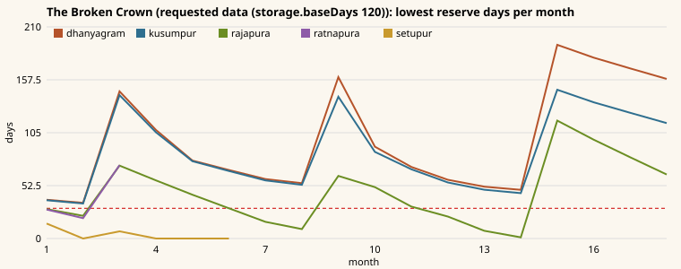

# SIM-01 campaign report (540 days)

Generated by `node scripts/sim/campaign-report.mjs` (headless, the real simulation; every player event answered with its first - safe default - choice, every engagement autoresolved, no other player input). Raw data: `campaign-report.json`.

Data as shipped: `RULES.storage.baseDays` 90 (CD-1, CD-2, CD-5 and CD-6 are applied). Requested data: `RULES.storage.baseDays` 120 (CD-8, see "Data requests").

## Outcomes

| Run | Outcome | Day | Score | Player settlements at the end | Battles | Revolts | Secessions | Real seconds |
|---|---|---|---|---|---|---|---|---|
| The Broken Crown - data as shipped (storage.baseDays 90) | ended (out_restored) | 540 | 1555 | rajapura, dhanyagram, kusumpur | 10 | 13 | 11 | 4.2 |
| The Seven Hills - data as shipped (storage.baseDays 90) | defeat (out_sh_fallen) | 232 | 187 | kandaravasa | 14 | 7 | 4 | 2.0 |
| Sandbox (default, Suvarna) - data as shipped (storage.baseDays 90) | ongoing (-) | 540 | 1194 | rajapura, dhanyagram, kusumpur, ratnapura, setupur | 3 | 9 | 8 | 1.3 |
| The Broken Crown - requested data (storage.baseDays 120) | ended (out_restored) | 540 | 1560 | rajapura, dhanyagram, kusumpur | 10 | 13 | 11 | 1.0 |
| The Seven Hills - requested data (storage.baseDays 120) | defeat (out_sh_fallen) | 232 | 304 | pashanagram, kandaravasa | 4 | 6 | 3 | 1.3 |
| Sandbox (default, Suvarna) - requested data (storage.baseDays 120) | ongoing (-) | 540 | 1200 | rajapura, dhanyagram, kusumpur, ratnapura, setupur | 3 | 7 | 5 | 1.2 |

### The Broken Crown, seeds 1-6 (every event auto-resolved)

- data as shipped (storage.baseDays 90): 6/6 mixed - seed 1: ended (out_restored) day 540; seed 2: ended (out_restored) day 540; seed 3: ended (out_restored) day 540; seed 4: ended (out_restored) day 540; seed 5: ended (out_restored) day 540; seed 6: ended (out_restored) day 540
- requested data (storage.baseDays 120): 6/6 mixed - seed 1: ended (out_restored) day 540; seed 2: ended (out_restored) day 540; seed 3: ended (out_restored) day 540; seed 4: ended (out_restored) day 540; seed 5: ended (out_restored) day 540; seed 6: ended (out_restored) day 540

### A passive sandbox player as each realm (seed 1, normal monsoon, no input; review B2)

Starving days = days with an empty store over the 540 days, whoever held the settlement, for each settlement the realm owned at the start (a seceded town keeps counting). Living court = the realm's living characters at the end (review B4: ruler, spouse, heir, general).

| Data | Realm | Outcome | Day | Settlements at the end | Starving days (settlements owned at the start) | Living court |
|---|---|---|---|---|---|---|
| shipped | heartland | ongoing (-) | 540 | rajapura, dhanyagram, kusumpur, ratnapura, setupur | rajapura 0, dhanyagram 0, kusumpur 0, ratnapura 0, setupur 0 | 4 |
| shipped | highland | defeat (realm_lost) | 233 | - | giridurg 53, shilapur 47, dvaradurga 49, pashanagram 44, kandaravasa 36 | 4 |
| shipped | forest | ongoing (-) | 540 | nilavanapura | nilavanapura 17, gajavana 180 | 4 |
| shipped | frontier | defeat (realm_lost) | 219 | - | lavanapura 71, ushtragram 47 | 4 |
| requested | heartland | ongoing (-) | 540 | rajapura, dhanyagram, kusumpur, ratnapura, setupur | rajapura 0, dhanyagram 0, kusumpur 0, ratnapura 0, setupur 0 | 4 |
| requested | highland | ongoing (-) | 541 | pashanagram, kandaravasa | giridurg 252, shilapur 254, dvaradurga 257, pashanagram 26, kandaravasa 29 | 4 |
| requested | forest | ongoing (-) | 541 | nilavanapura, gajavana | nilavanapura 25, gajavana 35 | 4 |
| requested | frontier | defeat (realm_lost) | 250 | - | lavanapura 62, ushtragram 16 | 4 |

## DESIGN_SPEC §13.2 grain calibration (annual civilian balance, measured with the daily economy)

| Realm | Target (normal) | data as shipped (storage.baseDays 90), M = 1 | M = 0.7 | requested data (storage.baseDays 120), M = 1 | M = 0.7 |
|---|---|---|---|---|---|
| heartland | +15% | +15.2% | -3.6% | +15.2% | -3.6% |
| highland | -9% | -10.8% | -25.9% | -10.5% | -25.9% |
| forest | +3% | +2.1% | -15.6% | +2.1% | -15.6% |
| frontier | -8% | -10.2% | -23.7% | -9.5% | -23.7% |

## Data requests (Creative Director, `src/data/**`)

Open:

1. **CD-8** `RULES.storage.baseDays` 90 -> **120** (the Creative Director's own review item B2; tests/sim/strategic/economy.test.ts now reads the value). A balanced settlement needs ~126 days of storage to hold its kharif (35% of the year) and carry the lean months to the next one; at 90 every settlement without a granary spills grain at harvest and starves before the next. Measured below: passive sandbox player per realm (shipped: heartland holds, highland lost day 233, forest holds, frontier lost day 219; requested: heartland holds, highland holds, forest holds, frontier lost day 250); The Broken Crown seeds 1-6 (shipped 6/6 mixed, requested 6/6 mixed); the §13.2 calibration does not move (it measures annual production).
2. **CD-3** Deficit realms (Giridurga -9%, Marudesha -8% by design) still starve every lean season unless someone buys or rations grain, and the flat +0.02/day starvation unrest walks them from famine to revolt to secession in ~45 days: with CD-8 a passive Marudesha player still loses the realm (realm lost on day 250; lavanapura 62, ushtragram 16 starving days). Please consider scaling that term by the unmet share of need (0.02 x deficit share) or raising their fertility; SIM-02 (campaign AI) is the other half - AI realms must use the market and the rationing rule. A deficit town that secedes never recovers: §7.3.1 production is linear in farm labor, so famine deaths shrink production as fast as need (Giridurg as a free town starved 150 days running in the passive Giridurga run); a rule for free towns in famine (shift labor to farming, or land-limited yields) would let them settle.
3. **CD-4** Landmark rules are keyed by landmark id in code (Royal Granary spoilage x0.5, Cliff Cistern besieged consumption x0.6, Elephant Grove elephant recruit time x0.7, Great Road royal-road speed); please add `LandmarkDef` fields (`spoilageFactor`, `besiegedConsumption`, `recruitTime: { war_elephants: 0.7 }`, `roadSpeed`).
4. **CD-7** Restate the DESIGN_SPEC worked examples with the real map and modifiers: Rajapura -> Giridurg is 114 km of road (4.3 days; the example assumed 81 km), 9.2 days across country (terrain + the river crossing); the Royal Host eats 195 grain/day and carries 23.5 days (27 with Suvarna supplyEfficiency 1.15); Giridurg (4,200 wall HP) falls in 52.5 days to one engineer formation at siegeStrength 1 (48 for Suvarna, 1.1); the Palace takes 144 days at constructionSpeed 1 (131 for Suvarna).

Applied:

- **CD-1** `RULES.population.laborHealthWeight` 0.5 -> 0 (applied in ba45410).
- **CD-2** `RULES.distribution.exportAboveDays` 120 -> 75 (applied in ba45410).
- **CD-5** `RULES.politics.offers.autonomy.taxShare` -0.25 -> -0.125, informational; the sim applies the §7.5 formula (applied in ba45410).
- **CD-6** `RULES.roads.repairWealthPerKm` and `RULES.politics.governor.loyaltyDrift` (applied in ba45410); the sim now reads them (commands.roadRepairCost, politics.governorLoyaltyTarget) instead of in-code constants.

## Contract requests (CTO)

- **CTO-1** `src/core/types.ts` Effect: add `{ kind: 'defect_character'; character: ScopeRef; to: ScopeRef; withArmies: boolean }` ('Let him go' sets `claimant_defected`, yet Prince Devavarman stays in the Suvarna court). SIM-01 then implements it in events.applyEffect: the character changes faction, leaves offices, council seat, heir role and governorship (as on death), his dynasty membership stays; with `withArmies` the armies he commands change owner with him; the Creative Director adds it to `evt_bc_gates_of_ratnapura/let_go`.

## The Broken Crown - data as shipped (storage.baseDays 90)

### Monthly ledger (player)

| Month | Date | Tax | Trade | Tribute | Army | Buildings | Admin | Net | Treasury | Royal reserve | Stability | Legitimacy | Settlements | Soldiers |
|---|---|---|---|---|---|---|---|---|---|---|---|---|---|---|
| 1 | -300/7 | 966 | 327 | 0 | 602 | 84 | 26 | 581 | 4,321 | 0 | 0.58 | 0.80 | 5 | 1,498 |
| 2 | -300/8 | 1,088 | 331 | 0 | 571 | 84 | 26 | 739 | 5,300 | 22,111 | 0.63 | 0.80 | 5 | 1,417 |
| 3 | -300/9 | 977 | 160 | 0 | 492 | 72 | 21 | 553 | 5,984 | 20,383 | 0.63 | 0.72 | 4 | 1,250 |
| 4 | -300/10 | 942 | 160 | 0 | 492 | 72 | 21 | 517 | 6,621 | 18,266 | 0.62 | 0.72 | 4 | 1,250 |
| 5 | -300/11 | 871 | 158 | 0 | 485 | 72 | 21 | 451 | 7,193 | 17,158 | 0.61 | 0.69 | 4 | 1,231 |
| 6 | -300/12 | 775 | 137 | 0 | 385 | 63 | 16 | 449 | 7,762 | 1,674 | 0.63 | 0.69 | 3 | 1,025 |
| 7 | -299/1 | 692 | 137 | 0 | 350 | 63 | 16 | 400 | 8,282 | 0 | 0.64 | 0.69 | 3 | 925 |
| 8 | -299/2 | 850 | 158 | 0 | 275 | 63 | 16 | 655 | 8,757 | 22,446 | 0.65 | 0.69 | 3 | 726 |
| 9 | -299/3 | 916 | 158 | 0 | 275 | 63 | 16 | 721 | 9,597 | 22,446 | 0.64 | 0.67 | 3 | 726 |
| 10 | -299/4 | 898 | 158 | 0 | 275 | 63 | 16 | 703 | 10,420 | 22,446 | 0.63 | 0.67 | 3 | 726 |
| 11 | -299/5 | 794 | 158 | 0 | 275 | 63 | 16 | 599 | 11,139 | 21,776 | 0.63 | 0.67 | 3 | 726 |
| 12 | -299/6 | 711 | 158 | 0 | 270 | 63 | 16 | 521 | 11,779 | 0 | 0.62 | 0.65 | 3 | 713 |
| 13 | -299/7 | 605 | 159 | 0 | 168 | 63 | 16 | 517 | 12,417 | 0 | 0.61 | 0.65 | 3 | 474 |
| 14 | -299/8 | 761 | 159 | 0 | 114 | 63 | 16 | 727 | 13,264 | 32,837 | 0.61 | 0.70 | 3 | 306 |
| 15 | -299/9 | 849 | 159 | 0 | 114 | 63 | 16 | 815 | 14,198 | 32,837 | 0.61 | 0.70 | 3 | 306 |
| 16 | -299/10 | 933 | 159 | 0 | 114 | 63 | 16 | 899 | 15,417 | 32,837 | 0.60 | 0.70 | 3 | 306 |
| 17 | -299/11 | 947 | 159 | 0 | 114 | 63 | 16 | 913 | 16,451 | 32,837 | 0.60 | 0.70 | 3 | 306 |
| 18 | -299/12 | 955 | 159 | 0 | 114 | 63 | 16 | 921 | 17,492 | 32,837 | 0.60 | 0.70 | 3 | 306 |

### Lowest reserve days in the month / highest unrest / worst stage

| Month | dhanyagram | kusumpur | rajapura | ratnapura | setupur |
|---|---|---|---|---|---|
| 1 | 38 d / 0.05 | 38 d / 0.05 | 29 d / 0.05 | 29 d / 0.31 | 15 d / 0.05 |
| 2 | 35 d / 0.00 | 35 d / 0.00 | 23 d / 0.01 | 20 d / 0.31 protest | 0 d / 0.05 |
| 3 | 146 d / 0.00 | 118 d / 0.00 | 72 d / 0.00 | 73 d / 0.22 grumbling | 7 d / 0.01 |
| 4 | 108 d / 0.00 | 92 d / 0.00 | 57 d / 0.00 | - | 0 d / 0.50 tax_refusal |
| 5 | 77 d / 0.00 | 74 d / 0.00 | 42 d / 0.00 | - | 0 d / 1.00 secession |
| 6 | 68 d / 0.00 | 64 d / 0.00 | 30 d / 0.00 | - | 0 d / 1.00 secession |
| 7 | 59 d / 0.00 | 55 d / 0.00 | 15 d / 0.03 | - | - |
| 8 | 55 d / 0.00 | 51 d / 0.00 | 8 d / 0.09 | - | - |
| 9 | 158 d / 0.05 | 113 d / 0.05 | 66 d / 0.09 | - | - |
| 10 | 92 d / 0.00 | 78 d / 0.00 | 49 d / 0.00 | - | - |
| 11 | 56 d / 0.00 | 64 d / 0.00 | 30 d / 0.00 | - | - |
| 12 | 43 d / 0.00 | 51 d / 0.00 | 20 d / 0.01 | - | - |
| 13 | 37 d / 0.00 | 44 d / 0.00 | 6 d / 0.11 | - | - |
| 14 | 33 d / 0.01 | 41 d / 0.00 | 0 d / 0.26 grumbling | - | - |
| 15 | 163 d / 0.00 | 118 d / 0.00 | 116 d / 0.24 grumbling | - | - |
| 16 | 151 d / 0.00 | 106 d / 0.00 | 97 d / 0.13 grumbling | - | - |
| 17 | 140 d / 0.00 | 96 d / 0.00 | 80 d / 0.02 | - | - |
| 18 | 130 d / 0.00 | 87 d / 0.00 | 63 d / 0.00 | - | - |

### Battles (10)

- day 9: The Battle of the Setu Bridge: Giridurga defeated Suvarna; 189 fell.
- day 69: The Battle of the Setu Bridge: Giridurga defeated Suvarna; 226 fell.
- day 172: The Battle of Sangam of the Two Rivers: Suvarna defeated Giridurga; 21 fell.
- day 175: The Battle of Sangam of the Two Rivers: Suvarna defeated Nilavana; 130 fell.
- day 189: The Battle of the White Flats: The rebels of Lavanapura defeated Marudesha; 4 fell.
- day 207: The Battle of the Dvara Pass: The rebels of Dvaradurga defeated Giridurga; 12 fell.
- day 208: The Battle of Ushtragram: The rebels of Ushtragram defeated Marudesha; 0 fell.
- day 214: The Battle of Pashanagram: The rebels of Pashanagram defeated Giridurga; 9 fell.
- day 242: The Battle of Kandaravasa: The rebels of Kandaravasa defeated Giridurga; 0 fell.
- day 347: The Battle of Gajavana: The rebels of Gajavana defeated Nilavana; 1 fell.

### Incidents

- day 63 - capture: Ratnapura: heartland -> forest
- day 63 - war: forest declared war on heartland
- day 129 - revolt: Setupur: 64 rebels
- day 136 - revolt: Setupur: 63 rebels
- day 166 - secession: Setupur left heartland
- day 189 - revolt: Lavanapura: 131 rebels
- day 193 - revolt: Ratnapura: 212 rebels
- day 207 - revolt: Dvaradurga: 71 rebels
- day 208 - revolt: Ushtragram: 40 rebels
- day 208 - capture: Ushtragram: frontier -> rebels
- day 210 - revolt: Shilapur: 166 rebels
- day 214 - revolt: Pashanagram: 48 rebels
- day 214 - capture: Pashanagram: highland -> rebels
- day 216 - revolt: Giridurg: 178 rebels
- day 219 - secession: Lavanapura left frontier
- day 223 - secession: Ratnapura left forest
- day 237 - secession: Dvaradurga left highland
- day 238 - secession: Ushtragram left rebels
- day 240 - secession: Shilapur left highland
- day 241 - revolt: Kandaravasa: 54 rebels
- day 242 - capture: Kandaravasa: highland -> rebels
- day 244 - secession: Pashanagram left rebels
- day 246 - secession: Giridurg left highland
- day 271 - secession: Kandaravasa left rebels
- day 301 - monsoon: M = 1.12 (normal)
- day 347 - revolt: Gajavana: 44 rebels
- day 347 - capture: Gajavana: forest -> rebels
- day 356 - revolt: Nilavanapura: 284 rebels
- day 377 - secession: Gajavana left rebels
- day 377 - revolt: Nilavanapura: 277 rebels
- day 407 - secession: Nilavanapura left forest

### Player events (30, first choice taken)

- day 1: The Broken Crown -> Take up the regency
- day 3: Whispers in the Hall of Pillars -> Proclaim Kumara Aditya heir before the court
- day 14: The Council of War -> Grain first: fill the granaries before the hot season
- day 23: The Prince's Letters -> Watch and wait
- day 31: Protest in Ratnapura -> Hear their grievances
- day 32: Envoys from the Seven Peaks -> Send them home: the bridge is ours
- day 46: A Thin Harvest -> Trust the winter crop
- day 52: Raiders at the Setu Bridge -> Repair what we can
- day 61: The Governor's Ultimatum -> Negotiate lower taxes
- day 63: The Gates of Ratnapura -> Let him go - and march
- day 109: Protest in Setupur -> Hear their grievances
- day 116: Tax Refusal in Setupur -> Negotiate a lower rate
- day 120: The Grain and the Sword -> Count the granaries
- day 123: Riots in Setupur -> Let it burn out
- day 129: Revolt in Setupur -> Negotiate with the rebel leaders
- day 138: Grain for the Host -> The host will live off the land
- day 151: Raiders at the Setu Bridge -> Repair what we can
- day 154: Protest in Setupur -> Hear their grievances
- day 180: The Temple Town Seeks a Protector -> Leave the sacred town free
- day 230: The Salt Caravan -> Buy salt for the granaries
- day 245: The Lean Months -> Hold the royal reserve for the army
- day 249: Fire in the Bazaar -> Let the merchants rebuild
- day 297: Raiders at the Setu Bridge -> Repair what we can
- day 300: The Monsoon Comes -> Wait for the rains
- day 312: The River Rises -> Endure it
- day 330: The Guild Charter of Naukapattana -> Decline politely
- day 346: The Regent Is Unwell -> Let her rest; the council keeps the seal
- day 406: Raiders at the Setu Bridge -> Repair what we can
- day 474: Pilgrims on the Road -> Welcome them
- day 515: The Year Turns -> Let them write

### Statistics

`grain_harvested` 1969582 · `events_resolved` 30 · `battles_fought` 4 · `enemies_killed` 239 · `soldiers_lost` 1344 · `formations_routed` 19 · `largest_battle` 1529 · `wealth_earned` 21096 · `trade_income` 3154 · `grain_spoiled` 67155 · `wars` 1 · `famine_days` 71 · `revolts` 2 · `settlements_lost_to_rebels` 1 · `battles_won` 2

## The Seven Hills - data as shipped (storage.baseDays 90)

### Monthly ledger (player)

| Month | Date | Tax | Trade | Tribute | Army | Buildings | Admin | Net | Treasury | Royal reserve | Stability | Legitimacy | Settlements | Soldiers |
|---|---|---|---|---|---|---|---|---|---|---|---|---|---|---|
| 1 | -300/7 | 320 | 52 | 0 | 320 | 66 | 16 | -29 | 2,966 | 0 | 0.57 | 0.61 | 5 | 951 |
| 2 | -300/8 | 356 | 52 | 0 | 294 | 66 | 16 | 33 | 3,478 | 6,747 | 0.57 | 0.62 | 5 | 858 |
| 3 | -300/9 | 360 | 52 | 0 | 294 | 66 | 16 | 37 | 3,695 | 6,747 | 0.62 | 0.63 | 5 | 858 |
| 4 | -300/10 | 328 | 52 | 0 | 292 | 66 | 16 | 7 | 4,182 | 0 | 0.63 | 0.64 | 5 | 848 |
| 5 | -300/11 | 257 | 52 | 0 | 239 | 66 | 16 | -11 | 4,651 | 0 | 0.63 | 0.65 | 5 | 655 |
| 6 | -300/12 | 130 | 20 | 0 | 115 | 66 | 16 | -47 | 4,999 | 0 | 0.61 | 0.63 | 5 | 310 |
| 7 | -299/1 | 36 | 6 | 0 | 47 | 36 | 10 | -50 | 5,112 | 0 | 0.57 | 0.64 | 3 | 124 |

### Lowest reserve days in the month / highest unrest / worst stage

| Month | dvaradurga | giridurg | kandaravasa | pashanagram | shilapur |
|---|---|---|---|---|---|
| 1 | 28 d / 0.05 | 35 d / 0.05 | 41 d / 0.05 | 38 d / 0.05 | 24 d / 0.05 |
| 2 | 19 d / 0.03 | 28 d / 0.00 | 36 d / 0.00 | 32 d / 0.00 | 13 d / 0.03 |
| 3 | 46 d / 0.00 | 67 d / 0.00 | 84 d / 0.00 | 72 d / 0.00 | 39 d / 0.00 |
| 4 | 25 d / 0.01 | 47 d / 0.00 | 69 d / 0.00 | 55 d / 0.00 | 23 d / 0.00 |
| 5 | 2 d / 0.13 | 22 d / 0.01 | 44 d / 0.00 | 31 d / 0.00 | 0 d / 0.26 grumbling |
| 6 | 0 d / 0.83 revolt | 3 d / 0.13 | 29 d / 0.01 | 14 d / 0.08 | 0 d / 1.00 secession |
| 7 | 0 d / 1.00 secession | 0 d / 1.00 secession | 14 d / 0.33 protest | 0 d / 0.42 protest | 0 d / 1.00 secession |

### Battles (14)

- day 10: The Battle of the Red Quarries: Suvarna defeated Giridurga; 296 fell.
- day 172: The Battle of the Dvara Pass: The rebels of Dvaradurga defeated Giridurga; 10 fell.
- day 189: The Battle of the White Flats: The rebels of Lavanapura defeated Marudesha; 4 fell.
- day 203: The Battle of Kandaravasa: neither Suvarna nor Giridurga could claim the field; 0 fell.
- day 208: The Battle of Ushtragram: The rebels of Ushtragram defeated Marudesha; 0 fell.
- day 215: The Battle of Kandaravasa: Suvarna defeated Giridurga; 11 fell.
- day 220: The Battle of Pashanagram: The rebels of Pashanagram defeated Giridurga; 0 fell.
- day 220: The Battle of the Dakshina Scarp: The rebels of Giridurg defeated Giridurga; 6 fell.
- day 220: The Battle of the Dakshina Scarp: Suvarna defeated Giridurga; 6 fell.
- day 221: The Battle of the Dakshina Scarp: Suvarna defeated Giridurga; 6 fell.
- day 222: The Battle of Shilapur: Suvarna defeated Giridurga; 5 fell.
- day 223: The Battle of Shilapur: Suvarna defeated Giridurga; 4 fell.
- day 224: The Battle of Kandaravasa: Suvarna defeated Giridurga; 3 fell.
- day 226: The Battle of Kandaravasa: Suvarna defeated Giridurga; 2 fell.

### Incidents

- day 171 - revolt: Shilapur: 163 rebels
- day 172 - revolt: Dvaradurga: 71 rebels
- day 178 - revolt: Dvaradurga: 70 rebels
- day 189 - revolt: Lavanapura: 131 rebels
- day 201 - secession: Shilapur left highland
- day 202 - revolt: Giridurg: 179 rebels
- day 208 - secession: Dvaradurga left highland
- day 208 - revolt: Ushtragram: 40 rebels
- day 208 - capture: Ushtragram: frontier -> rebels
- day 219 - secession: Lavanapura left frontier
- day 220 - revolt: Pashanagram: 49 rebels
- day 220 - capture: Pashanagram: highland -> rebels
- day 232 - secession: Giridurg left highland

### Player events (16, first choice taken)

- day 1: The Seven Hills -> Ring the assembly drum
- day 8: The Hungry Plateau -> Ration the clans
- day 25: Lowland Patrols -> Endure it
- day 28: A Letter from Ratnapura -> Burn the letter
- day 70: The Assembly of the Seven Clans -> Seek consensus
- day 121: Lowland Patrols -> Endure it
- day 140: The River Oath -> Look to the river
- day 153: Protest in Shilapur -> Hear their grievances
- day 155: Bandits on the Road -> Let the villages deal with it
- day 160: Tax Refusal in Shilapur -> Negotiate a lower rate
- day 168: Riots in Dvaradurga -> Let it burn out
- day 170: Riders of the Salt Road -> Decline the alliance
- day 174: Revolt in Dvaradurga -> Negotiate with the rebel leaders
- day 199: Protest in Dvaradurga -> Hear their grievances
- day 212: The Salt Caravan -> Buy salt for the granaries
- day 220: Lowland Patrols -> Endure it

### Statistics

`grain_harvested` 274594 · `events_resolved` 16 · `battles_fought` 12 · `enemies_killed` 92 · `soldiers_lost` 1129 · `formations_routed` 12 · `largest_battle` 1552 · `wealth_earned` 5032 · `trade_income` 287 · `grain_spoiled` 10193 · `famine_days` 171 · `revolts` 5 · `settlements_lost_to_rebels` 3

## Sandbox (default, Suvarna) - data as shipped (storage.baseDays 90)

### Monthly ledger (player)

| Month | Date | Tax | Trade | Tribute | Army | Buildings | Admin | Net | Treasury | Royal reserve | Stability | Legitimacy | Settlements | Soldiers |
|---|---|---|---|---|---|---|---|---|---|---|---|---|---|---|
| 1 | -300/1 | 1,169 | 307 | 0 | 197 | 84 | 26 | 1,169 | 4,409 | 2,000 | 0.61 | 0.61 | 5 | 632 |
| 2 | -300/2 | 1,165 | 311 | 0 | 197 | 84 | 26 | 1,170 | 5,819 | 40,959 | 0.61 | 0.62 | 5 | 632 |
| 3 | -300/3 | 1,179 | 311 | 0 | 197 | 84 | 26 | 1,184 | 7,243 | 40,959 | 0.61 | 0.63 | 5 | 632 |
| 4 | -300/4 | 1,184 | 311 | 0 | 197 | 84 | 26 | 1,189 | 8,673 | 40,959 | 0.62 | 0.64 | 5 | 632 |
| 5 | -300/5 | 1,164 | 311 | 0 | 197 | 84 | 26 | 1,169 | 10,081 | 40,959 | 0.62 | 0.65 | 5 | 632 |
| 6 | -300/6 | 1,026 | 312 | 0 | 197 | 84 | 26 | 1,031 | 11,352 | 33,434 | 0.64 | 0.66 | 5 | 632 |
| 7 | -300/7 | 928 | 312 | 0 | 197 | 84 | 26 | 933 | 12,525 | 0 | 0.64 | 0.67 | 5 | 632 |
| 8 | -300/8 | 1,095 | 312 | 0 | 197 | 84 | 26 | 1,100 | 13,865 | 42,237 | 0.64 | 0.68 | 5 | 632 |
| 9 | -300/9 | 1,167 | 312 | 0 | 197 | 84 | 26 | 1,172 | 15,277 | 42,237 | 0.63 | 0.69 | 5 | 632 |
| 10 | -300/10 | 1,188 | 312 | 0 | 197 | 84 | 26 | 1,194 | 16,711 | 42,237 | 0.63 | 0.70 | 5 | 632 |
| 11 | -300/11 | 1,200 | 312 | 0 | 197 | 84 | 26 | 1,205 | 17,856 | 42,237 | 0.63 | 0.71 | 5 | 632 |
| 12 | -300/12 | 1,187 | 312 | 0 | 197 | 84 | 26 | 1,192 | 19,288 | 42,237 | 0.63 | 0.72 | 5 | 632 |
| 13 | -299/1 | 1,061 | 312 | 0 | 197 | 84 | 26 | 1,067 | 20,595 | 41,760 | 0.63 | 0.73 | 5 | 632 |
| 14 | -299/2 | 1,151 | 312 | 0 | 197 | 84 | 26 | 1,156 | 21,991 | 67,513 | 0.63 | 0.74 | 5 | 632 |
| 15 | -299/3 | 1,174 | 312 | 0 | 197 | 84 | 26 | 1,180 | 23,411 | 67,513 | 0.63 | 0.75 | 5 | 632 |
| 16 | -299/4 | 1,184 | 312 | 0 | 197 | 84 | 26 | 1,190 | 24,841 | 67,513 | 0.63 | 0.76 | 5 | 632 |
| 17 | -299/5 | 1,095 | 312 | 0 | 197 | 84 | 26 | 1,101 | 26,182 | 67,513 | 0.64 | 0.77 | 5 | 632 |
| 18 | -299/6 | 955 | 313 | 0 | 197 | 84 | 26 | 961 | 27,383 | 33,293 | 0.64 | 0.78 | 5 | 632 |

### Lowest reserve days in the month / highest unrest / worst stage

| Month | dhanyagram | kusumpur | rajapura | ratnapura | setupur |
|---|---|---|---|---|---|
| 1 | 66 d / 0.05 | 66 d / 0.05 | 58 d / 0.05 | 55 d / 0.05 | 57 d / 0.05 |
| 2 | 62 d / 0.00 | 61 d / 0.00 | 49 d / 0.00 | 45 d / 0.00 | 48 d / 0.00 |
| 3 | 153 d / 0.00 | 110 d / 0.00 | 107 d / 0.00 | 60 d / 0.00 | 60 d / 0.00 |
| 4 | 108 d / 0.00 | 83 d / 0.00 | 77 d / 0.00 | 60 d / 0.00 | 60 d / 0.00 |
| 5 | 62 d / 0.00 | 67 d / 0.00 | 57 d / 0.00 | 43 d / 0.00 | 44 d / 0.00 |
| 6 | 50 d / 0.05 | 54 d / 0.05 | 37 d / 0.05 | 30 d / 0.06 | 30 d / 0.06 |
| 7 | 43 d / 0.02 | 47 d / 0.02 | 29 d / 0.00 | 29 d / 0.10 | 28 d / 0.10 |
| 8 | 40 d / 0.00 | 44 d / 0.00 | 22 d / 0.01 | 20 d / 0.13 | 21 d / 0.14 |
| 9 | 162 d / 0.00 | 118 d / 0.00 | 118 d / 0.00 | 60 d / 0.10 | 61 d / 0.12 |
| 10 | 134 d / 0.00 | 99 d / 0.00 | 92 d / 0.00 | 60 d / 0.03 | 60 d / 0.05 |
| 11 | 95 d / 0.00 | 80 d / 0.00 | 72 d / 0.00 | 58 d / 0.00 | 58 d / 0.00 |
| 12 | 76 d / 0.00 | 71 d / 0.00 | 57 d / 0.00 | 45 d / 0.00 | 47 d / 0.00 |
| 13 | 39 d / 0.00 | 61 d / 0.00 | 40 d / 0.00 | 30 d / 0.00 | 30 d / 0.00 |
| 14 | 35 d / 0.15 | 57 d / 0.00 | 32 d / 0.00 | 30 d / 0.02 | 30 d / 0.02 |
| 15 | 147 d / 0.12 | 109 d / 0.00 | 90 d / 0.00 | 60 d / 0.00 | 60 d / 0.00 |
| 16 | 90 d / 0.00 | 77 d / 0.00 | 65 d / 0.00 | 55 d / 0.00 | 55 d / 0.00 |
| 17 | 69 d / 0.00 | 62 d / 0.00 | 44 d / 0.00 | 34 d / 0.00 | 35 d / 0.00 |
| 18 | 55 d / 0.00 | 47 d / 0.00 | 30 d / 0.00 | 30 d / 0.02 | 30 d / 0.03 |

### Battles (3)

- day 183: The Battle of the White Flats: The rebels of Lavanapura defeated Marudesha; 31 fell.
- day 189: The Battle of Ushtragram: The rebels of Ushtragram defeated Marudesha; 24 fell.
- day 198: The Battle of the Dakshina Scarp: The rebels of Giridurg defeated Giridurga; 35 fell.

### Incidents

- day 121 - monsoon: M = 0.95 (normal)
- day 183 - revolt: Lavanapura: 129 rebels
- day 189 - revolt: Lavanapura: 128 rebels
- day 189 - revolt: Ushtragram: 39 rebels
- day 189 - capture: Ushtragram: frontier -> rebels
- day 197 - revolt: Dvaradurga: 69 rebels
- day 198 - revolt: Giridurg: 178 rebels
- day 198 - revolt: Shilapur: 166 rebels
- day 200 - revolt: Pashanagram: 48 rebels
- day 203 - revolt: Gajavana: 42 rebels
- day 206 - revolt: Kandaravasa: 54 rebels
- day 219 - secession: Lavanapura left frontier
- day 219 - secession: Ushtragram left rebels
- day 227 - secession: Dvaradurga left highland
- day 228 - secession: Giridurg left highland
- day 228 - secession: Shilapur left highland
- day 230 - secession: Pashanagram left highland
- day 233 - secession: Gajavana left forest
- day 236 - secession: Kandaravasa left highland
- day 481 - monsoon: M = 0.56 (failed)

### Player events (8, first choice taken)

- day 116: Fire in the Bazaar -> Let the merchants rebuild
- day 133: The River Rises -> Endure it
- day 164: The Rains Fail -> Pray for rain
- day 298: The Elephant Fair at Gajavana -> Not this year
- day 330: The Salt Caravan -> Buy salt for the granaries
- day 381: Grain for the Host -> Requisition the grain
- day 406: The Price of Bread -> Markets will settle on their own
- day 446: The Governor's Ultimatum -> Negotiate lower taxes

### Statistics

`grain_harvested` 2256995 · `wealth_earned` 30200 · `trade_income` 5609 · `grain_spoiled` 141437 · `events_resolved` 8

## The Broken Crown - requested data (storage.baseDays 120)

### Monthly ledger (player)

| Month | Date | Tax | Trade | Tribute | Army | Buildings | Admin | Net | Treasury | Royal reserve | Stability | Legitimacy | Settlements | Soldiers |
|---|---|---|---|---|---|---|---|---|---|---|---|---|---|---|
| 1 | -300/7 | 966 | 327 | 0 | 602 | 84 | 26 | 581 | 4,321 | 0 | 0.58 | 0.80 | 5 | 1,498 |
| 2 | -300/8 | 1,088 | 331 | 0 | 571 | 84 | 26 | 739 | 5,300 | 22,111 | 0.63 | 0.80 | 5 | 1,417 |
| 3 | -300/9 | 977 | 160 | 0 | 492 | 72 | 21 | 553 | 5,984 | 20,383 | 0.63 | 0.72 | 4 | 1,250 |
| 4 | -300/10 | 945 | 160 | 0 | 492 | 72 | 21 | 519 | 6,624 | 18,266 | 0.62 | 0.72 | 4 | 1,250 |
| 5 | -300/11 | 881 | 158 | 0 | 485 | 72 | 21 | 462 | 7,206 | 17,158 | 0.61 | 0.69 | 4 | 1,230 |
| 6 | -300/12 | 781 | 158 | 0 | 390 | 63 | 16 | 470 | 7,795 | 6,024 | 0.63 | 0.69 | 3 | 1,013 |
| 7 | -299/1 | 702 | 137 | 0 | 359 | 63 | 16 | 402 | 8,318 | 0 | 0.64 | 0.67 | 3 | 928 |
| 8 | -299/2 | 853 | 158 | 0 | 298 | 63 | 16 | 635 | 9,073 | 22,750 | 0.65 | 0.67 | 3 | 787 |
| 9 | -299/3 | 916 | 158 | 0 | 298 | 63 | 16 | 697 | 9,890 | 22,750 | 0.64 | 0.65 | 3 | 787 |
| 10 | -299/4 | 896 | 158 | 0 | 298 | 63 | 16 | 678 | 10,388 | 22,750 | 0.63 | 0.65 | 3 | 787 |
| 11 | -299/5 | 803 | 158 | 0 | 298 | 63 | 16 | 585 | 11,093 | 22,750 | 0.62 | 0.65 | 3 | 787 |
| 12 | -299/6 | 726 | 158 | 0 | 297 | 63 | 16 | 509 | 11,722 | 0 | 0.64 | 0.65 | 3 | 781 |
| 13 | -299/7 | 624 | 159 | 0 | 240 | 63 | 16 | 464 | 12,307 | 0 | 0.63 | 0.65 | 3 | 598 |
| 14 | -299/8 | 777 | 159 | 0 | 135 | 63 | 16 | 722 | 13,149 | 34,372 | 0.62 | 0.70 | 3 | 392 |
| 15 | -299/9 | 906 | 159 | 0 | 135 | 63 | 16 | 851 | 14,320 | 34,372 | 0.62 | 0.70 | 3 | 392 |
| 16 | -299/10 | 931 | 159 | 0 | 135 | 63 | 16 | 876 | 15,315 | 34,372 | 0.61 | 0.70 | 3 | 392 |
| 17 | -299/11 | 946 | 159 | 0 | 135 | 63 | 16 | 891 | 16,327 | 34,372 | 0.61 | 0.70 | 3 | 392 |
| 18 | -299/12 | 955 | 159 | 0 | 135 | 63 | 16 | 900 | 17,347 | 34,372 | 0.61 | 0.70 | 3 | 392 |

### Lowest reserve days in the month / highest unrest / worst stage

| Month | dhanyagram | kusumpur | rajapura | ratnapura | setupur |
|---|---|---|---|---|---|
| 1 | 38 d / 0.05 | 38 d / 0.05 | 29 d / 0.05 | 29 d / 0.31 | 15 d / 0.05 |
| 2 | 35 d / 0.00 | 35 d / 0.00 | 23 d / 0.01 | 20 d / 0.31 protest | 0 d / 0.05 |
| 3 | 146 d / 0.00 | 142 d / 0.00 | 72 d / 0.00 | 73 d / 0.22 grumbling | 7 d / 0.01 |
| 4 | 108 d / 0.00 | 105 d / 0.00 | 58 d / 0.00 | - | 0 d / 0.50 tax_refusal |
| 5 | 77 d / 0.00 | 77 d / 0.00 | 43 d / 0.00 | - | 0 d / 1.00 secession |
| 6 | 68 d / 0.00 | 67 d / 0.00 | 30 d / 0.00 | - | 0 d / 1.00 secession |
| 7 | 59 d / 0.00 | 58 d / 0.00 | 17 d / 0.03 | - | - |
| 8 | 55 d / 0.00 | 53 d / 0.00 | 9 d / 0.08 | - | - |
| 9 | 160 d / 0.05 | 141 d / 0.05 | 62 d / 0.08 | - | - |
| 10 | 91 d / 0.00 | 86 d / 0.00 | 51 d / 0.00 | - | - |
| 11 | 71 d / 0.00 | 69 d / 0.00 | 32 d / 0.00 | - | - |
| 12 | 58 d / 0.05 | 56 d / 0.05 | 22 d / 0.06 | - | - |
| 13 | 51 d / 0.03 | 48 d / 0.03 | 8 d / 0.14 | - | - |
| 14 | 48 d / 0.00 | 45 d / 0.00 | 1 d / 0.23 grumbling | - | - |
| 15 | 192 d / 0.00 | 148 d / 0.00 | 117 d / 0.21 grumbling | - | - |
| 16 | 179 d / 0.00 | 135 d / 0.00 | 98 d / 0.10 | - | - |
| 17 | 169 d / 0.00 | 125 d / 0.00 | 81 d / 0.00 | - | - |
| 18 | 158 d / 0.00 | 115 d / 0.00 | 64 d / 0.00 | - | - |

### Battles (10)

- day 9: The Battle of the Setu Bridge: Giridurga defeated Suvarna; 189 fell.
- day 69: The Battle of the Setu Bridge: Giridurga defeated Suvarna; 226 fell.
- day 172: The Battle of Sangam of the Two Rivers: Suvarna defeated Giridurga; 21 fell.
- day 173: The Battle of Sangam of the Two Rivers: Suvarna defeated Nilavana; 159 fell.
- day 208: The Battle of the White Flats: The rebels of Lavanapura defeated Marudesha; 4 fell.
- day 221: The Battle of the Dvara Pass: The rebels of Dvaradurga defeated Giridurga; 12 fell.
- day 341: The Battle of Pashanagram: The rebels of Pashanagram defeated Giridurga; 1 fell.
- day 346: The Battle of Ushtragram: The rebels of Ushtragram defeated Marudesha; 0 fell.
- day 374: The Battle of Gajavana: The rebels of Gajavana defeated Nilavana; 0 fell.
- day 386: The Battle of Kandaravasa: The rebels of Kandaravasa defeated Giridurga; 0 fell.

### Incidents

- day 63 - capture: Ratnapura: heartland -> forest
- day 63 - war: forest declared war on heartland
- day 129 - revolt: Setupur: 64 rebels
- day 136 - revolt: Setupur: 63 rebels
- day 166 - secession: Setupur left heartland
- day 189 - revolt: Ratnapura: 213 rebels
- day 208 - revolt: Lavanapura: 131 rebels
- day 219 - secession: Ratnapura left forest
- day 221 - revolt: Dvaradurga: 71 rebels
- day 225 - revolt: Shilapur: 166 rebels
- day 226 - revolt: Giridurg: 178 rebels
- day 238 - secession: Lavanapura left frontier
- day 251 - secession: Dvaradurga left highland
- day 255 - secession: Shilapur left highland
- day 273 - revolt: Giridurg: 178 rebels
- day 301 - monsoon: M = 1.12 (normal)
- day 303 - secession: Giridurg left highland
- day 341 - revolt: Pashanagram: 51 rebels
- day 341 - capture: Pashanagram: highland -> rebels
- day 346 - revolt: Ushtragram: 40 rebels
- day 346 - capture: Ushtragram: frontier -> rebels
- day 359 - revolt: Nilavanapura: 283 rebels
- day 371 - secession: Pashanagram left rebels
- day 374 - revolt: Gajavana: 47 rebels
- day 374 - capture: Gajavana: forest -> rebels
- day 376 - secession: Ushtragram left rebels
- day 386 - revolt: Kandaravasa: 55 rebels
- day 386 - capture: Kandaravasa: highland -> rebels
- day 389 - secession: Nilavanapura left forest
- day 404 - secession: Gajavana left rebels
- day 416 - secession: Kandaravasa left rebels

### Player events (31, first choice taken)

- day 1: The Broken Crown -> Take up the regency
- day 3: Whispers in the Hall of Pillars -> Proclaim Kumara Aditya heir before the court
- day 14: The Council of War -> Grain first: fill the granaries before the hot season
- day 23: The Prince's Letters -> Watch and wait
- day 31: Protest in Ratnapura -> Hear their grievances
- day 32: Envoys from the Seven Peaks -> Send them home: the bridge is ours
- day 46: A Thin Harvest -> Trust the winter crop
- day 52: Raiders at the Setu Bridge -> Repair what we can
- day 61: The Governor's Ultimatum -> Negotiate lower taxes
- day 63: The Gates of Ratnapura -> Let him go - and march
- day 109: Protest in Setupur -> Hear their grievances
- day 116: Tax Refusal in Setupur -> Negotiate a lower rate
- day 120: The Grain and the Sword -> Count the granaries
- day 123: Riots in Setupur -> Let it burn out
- day 129: Revolt in Setupur -> Negotiate with the rebel leaders
- day 138: Grain for the Host -> The host will live off the land
- day 155: Protest in Setupur -> Hear their grievances
- day 180: The Temple Town Seeks a Protector -> Leave the sacred town free
- day 190: Raiders at the Setu Bridge -> Repair what we can
- day 208: The Regent Is Unwell -> Let her rest; the council keeps the seal
- day 245: The Lean Months -> Hold the royal reserve for the army
- day 261: Fire in the Bazaar -> Let the merchants rebuild
- day 286: Raiders at the Setu Bridge -> Repair what we can
- day 296: The Salt Caravan -> Buy salt for the granaries
- day 300: The Monsoon Comes -> Wait for the rains
- day 330: The Guild Charter of Naukapattana -> Decline politely
- day 348: The Rains Fail -> Pray for rain
- day 412: Raiders at the Setu Bridge -> Repair what we can
- day 436: Pilgrims on the Road -> Welcome them
- day 473: Raiders at the Setu Bridge -> Repair what we can
- day 515: The Year Turns -> Let them write

### Statistics

`grain_harvested` 1970252 · `events_resolved` 31 · `battles_fought` 4 · `enemies_killed` 253 · `soldiers_lost` 1258 · `formations_routed` 19 · `largest_battle` 1532 · `wealth_earned` 21260 · `trade_income` 3175 · `wars` 1 · `famine_days` 69 · `revolts` 2 · `settlements_lost_to_rebels` 1 · `battles_won` 2 · `grain_spoiled` 39004

## The Seven Hills - requested data (storage.baseDays 120)

### Monthly ledger (player)

| Month | Date | Tax | Trade | Tribute | Army | Buildings | Admin | Net | Treasury | Royal reserve | Stability | Legitimacy | Settlements | Soldiers |
|---|---|---|---|---|---|---|---|---|---|---|---|---|---|---|
| 1 | -300/7 | 320 | 52 | 0 | 320 | 66 | 16 | -29 | 2,966 | 0 | 0.57 | 0.61 | 5 | 951 |
| 2 | -300/8 | 356 | 52 | 0 | 294 | 66 | 16 | 33 | 3,478 | 6,747 | 0.57 | 0.62 | 5 | 858 |
| 3 | -300/9 | 362 | 52 | 0 | 294 | 66 | 16 | 39 | 3,697 | 6,747 | 0.62 | 0.63 | 5 | 858 |
| 4 | -300/10 | 330 | 52 | 0 | 294 | 66 | 16 | 7 | 4,184 | 0 | 0.63 | 0.64 | 5 | 855 |
| 5 | -300/11 | 267 | 52 | 0 | 241 | 66 | 16 | -3 | 4,661 | 0 | 0.63 | 0.65 | 5 | 664 |
| 6 | -300/12 | 139 | 22 | 0 | 116 | 66 | 16 | -36 | 5,058 | 0 | 0.61 | 0.63 | 5 | 315 |
| 7 | -299/1 | 50 | 7 | 0 | 50 | 53 | 13 | -59 | 5,174 | 0 | 0.59 | 0.64 | 4 | 137 |

### Lowest reserve days in the month / highest unrest / worst stage

| Month | dvaradurga | giridurg | kandaravasa | pashanagram | shilapur |
|---|---|---|---|---|---|
| 1 | 28 d / 0.05 | 35 d / 0.05 | 41 d / 0.05 | 38 d / 0.05 | 24 d / 0.05 |
| 2 | 19 d / 0.03 | 28 d / 0.00 | 36 d / 0.00 | 32 d / 0.00 | 13 d / 0.03 |
| 3 | 47 d / 0.00 | 67 d / 0.00 | 118 d / 0.00 | 78 d / 0.00 | 41 d / 0.00 |
| 4 | 26 d / 0.01 | 47 d / 0.00 | 102 d / 0.00 | 60 d / 0.00 | 25 d / 0.00 |
| 5 | 3 d / 0.12 | 22 d / 0.01 | 72 d / 0.00 | 35 d / 0.00 | 0 d / 0.04 |
| 6 | 0 d / 0.86 secession | 3 d / 0.13 | 56 d / 0.00 | 17 d / 0.05 | 0 d / 0.92 secession |
| 7 | 0 d / 1.00 secession | 0 d / 1.00 secession | 33 d / 0.20 grumbling | 1 d / 0.23 grumbling | 0 d / 1.00 secession |

### Battles (4)

- day 10: The Battle of the Red Quarries: Suvarna defeated Giridurga; 296 fell.
- day 176: The Battle of the Dvara Pass: The rebels of Dvaradurga defeated Giridurga; 7 fell.
- day 208: The Battle of the White Flats: The rebels of Lavanapura defeated Marudesha; 5 fell.
- day 208: The Battle of Kandaravasa: neither Suvarna nor Giridurga could claim the field; 0 fell.

### Incidents

- day 176 - revolt: Dvaradurga: 71 rebels
- day 176 - revolt: Shilapur: 163 rebels
- day 182 - revolt: Dvaradurga: 70 rebels
- day 202 - revolt: Giridurg: 179 rebels
- day 206 - secession: Shilapur left highland
- day 208 - revolt: Lavanapura: 131 rebels
- day 212 - secession: Dvaradurga left highland
- day 232 - secession: Giridurg left highland
- day 232 - revolt: Pashanagram: 50 rebels

### Player events (13, first choice taken)

- day 1: The Seven Hills -> Ring the assembly drum
- day 8: The Hungry Plateau -> Ration the clans
- day 25: Lowland Patrols -> Endure it
- day 28: A Letter from Ratnapura -> Burn the letter
- day 70: The Assembly of the Seven Clans -> Seek consensus
- day 140: The River Oath -> Look to the river
- day 161: Protest in Dvaradurga -> Hear their grievances
- day 164: Lowland Patrols -> Endure it
- day 165: Tax Refusal in Shilapur -> Negotiate a lower rate
- day 170: Riders of the Salt Road -> Decline the alliance
- day 171: Riots in Dvaradurga -> Let it burn out
- day 179: Revolt in Dvaradurga -> Negotiate with the rebel leaders
- day 206: Protest in Dvaradurga -> Hear their grievances

### Statistics

`grain_harvested` 288586 · `events_resolved` 13 · `battles_fought` 3 · `enemies_killed` 92 · `soldiers_lost` 1039 · `formations_routed` 14 · `largest_battle` 1552 · `wealth_earned` 5123 · `trade_income` 290 · `grain_spoiled` 212 · `famine_days` 168 · `revolts` 5 · `settlements_lost_to_rebels` 3

## Sandbox (default, Suvarna) - requested data (storage.baseDays 120)

### Monthly ledger (player)

| Month | Date | Tax | Trade | Tribute | Army | Buildings | Admin | Net | Treasury | Royal reserve | Stability | Legitimacy | Settlements | Soldiers |
|---|---|---|---|---|---|---|---|---|---|---|---|---|---|---|
| 1 | -300/1 | 1,169 | 307 | 0 | 197 | 84 | 26 | 1,169 | 4,409 | 2,000 | 0.61 | 0.61 | 5 | 632 |
| 2 | -300/2 | 1,165 | 311 | 0 | 197 | 84 | 26 | 1,170 | 5,819 | 40,959 | 0.61 | 0.62 | 5 | 632 |
| 3 | -300/3 | 1,179 | 311 | 0 | 197 | 84 | 26 | 1,184 | 7,243 | 40,959 | 0.61 | 0.63 | 5 | 632 |
| 4 | -300/4 | 1,185 | 311 | 0 | 197 | 84 | 26 | 1,189 | 8,673 | 40,959 | 0.62 | 0.64 | 5 | 632 |
| 5 | -300/5 | 1,185 | 311 | 0 | 197 | 84 | 26 | 1,189 | 10,102 | 40,959 | 0.62 | 0.65 | 5 | 632 |
| 6 | -300/6 | 1,089 | 312 | 0 | 197 | 84 | 26 | 1,094 | 11,436 | 40,959 | 0.63 | 0.66 | 5 | 632 |
| 7 | -300/7 | 966 | 312 | 0 | 197 | 84 | 26 | 972 | 12,648 | 22,664 | 0.62 | 0.67 | 5 | 632 |
| 8 | -300/8 | 1,119 | 311 | 0 | 197 | 84 | 26 | 1,123 | 14,011 | 44,753 | 0.62 | 0.68 | 5 | 632 |
| 9 | -300/9 | 1,178 | 312 | 0 | 197 | 84 | 26 | 1,183 | 15,134 | 44,753 | 0.62 | 0.69 | 5 | 632 |
| 10 | -300/10 | 1,204 | 312 | 0 | 197 | 84 | 26 | 1,210 | 16,783 | 44,753 | 0.62 | 0.70 | 5 | 632 |
| 11 | -300/11 | 1,210 | 312 | 0 | 197 | 84 | 26 | 1,215 | 18,239 | 44,753 | 0.62 | 0.71 | 5 | 632 |
| 12 | -300/12 | 1,214 | 312 | 0 | 197 | 84 | 26 | 1,220 | 19,698 | 44,753 | 0.62 | 0.72 | 5 | 632 |
| 13 | -299/1 | 1,191 | 312 | 0 | 197 | 84 | 26 | 1,197 | 21,135 | 47,753 | 0.63 | 0.73 | 5 | 632 |
| 14 | -299/2 | 1,194 | 312 | 0 | 197 | 84 | 26 | 1,200 | 22,575 | 85,564 | 0.63 | 0.74 | 5 | 632 |
| 15 | -299/3 | 1,188 | 312 | 0 | 197 | 84 | 26 | 1,194 | 24,009 | 85,564 | 0.63 | 0.75 | 5 | 632 |
| 16 | -299/4 | 1,195 | 312 | 0 | 197 | 84 | 26 | 1,201 | 25,450 | 85,564 | 0.63 | 0.76 | 5 | 632 |
| 17 | -299/5 | 1,193 | 312 | 0 | 197 | 84 | 26 | 1,199 | 26,888 | 85,564 | 0.63 | 0.77 | 5 | 632 |
| 18 | -299/6 | 1,056 | 313 | 0 | 197 | 84 | 26 | 1,062 | 28,190 | 85,564 | 0.63 | 0.78 | 5 | 632 |

### Lowest reserve days in the month / highest unrest / worst stage

| Month | dhanyagram | kusumpur | rajapura | ratnapura | setupur |
|---|---|---|---|---|---|
| 1 | 66 d / 0.05 | 66 d / 0.05 | 58 d / 0.05 | 55 d / 0.05 | 57 d / 0.05 |
| 2 | 62 d / 0.00 | 61 d / 0.00 | 49 d / 0.00 | 45 d / 0.00 | 48 d / 0.00 |
| 3 | 177 d / 0.00 | 141 d / 0.00 | 109 d / 0.00 | 80 d / 0.00 | 86 d / 0.00 |
| 4 | 154 d / 0.00 | 120 d / 0.00 | 85 d / 0.00 | 60 d / 0.00 | 63 d / 0.00 |
| 5 | 82 d / 0.00 | 82 d / 0.00 | 63 d / 0.00 | 55 d / 0.00 | 55 d / 0.00 |
| 6 | 67 d / 0.00 | 67 d / 0.00 | 43 d / 0.00 | 34 d / 0.00 | 36 d / 0.00 |
| 7 | 60 d / 0.00 | 60 d / 0.00 | 30 d / 0.00 | 30 d / 0.02 | 30 d / 0.02 |
| 8 | 57 d / 0.00 | 56 d / 0.00 | 29 d / 0.00 | 29 d / 0.04 | 29 d / 0.05 |
| 9 | 199 d / 0.00 | 154 d / 0.00 | 132 d / 0.00 | 92 d / 0.01 | 95 d / 0.02 |
| 10 | 189 d / 0.00 | 143 d / 0.00 | 112 d / 0.00 | 71 d / 0.00 | 75 d / 0.00 |
| 11 | 169 d / 0.00 | 127 d / 0.00 | 92 d / 0.00 | 60 d / 0.00 | 60 d / 0.00 |
| 12 | 122 d / 0.00 | 98 d / 0.00 | 72 d / 0.00 | 60 d / 0.00 | 60 d / 0.00 |
| 13 | 51 d / 0.00 | 75 d / 0.00 | 54 d / 0.00 | 50 d / 0.00 | 51 d / 0.00 |
| 14 | 47 d / 0.15 | 71 d / 0.00 | 46 d / 0.00 | 40 d / 0.00 | 42 d / 0.00 |
| 15 | 162 d / 0.12 | 141 d / 0.00 | 105 d / 0.00 | 75 d / 0.00 | 86 d / 0.00 |
| 16 | 134 d / 0.00 | 116 d / 0.00 | 80 d / 0.00 | 60 d / 0.00 | 63 d / 0.00 |
| 17 | 83 d / 0.00 | 78 d / 0.00 | 58 d / 0.00 | 53 d / 0.00 | 53 d / 0.00 |
| 18 | 66 d / 0.00 | 63 d / 0.00 | 37 d / 0.00 | 31 d / 0.00 | 33 d / 0.00 |

### Battles (3)

- day 198: The Battle of the White Flats: The rebels of Lavanapura defeated Marudesha; 33 fell.
- day 217: The Battle of the Dakshina Scarp: The rebels of Giridurg defeated Giridurga; 34 fell.
- day 235: The Battle of Ushtragram: Marudesha defeated the rebels of Ushtragram; 32 fell.

### Incidents

- day 121 - monsoon: M = 0.95 (normal)
- day 198 - revolt: Lavanapura: 129 rebels
- day 205 - revolt: Lavanapura: 128 rebels
- day 215 - revolt: Dvaradurga: 69 rebels
- day 217 - revolt: Giridurg: 178 rebels
- day 223 - revolt: Shilapur: 166 rebels
- day 235 - secession: Lavanapura left frontier
- day 235 - revolt: Ushtragram: 42 rebels
- day 245 - secession: Dvaradurga left highland
- day 247 - secession: Giridurg left highland
- day 253 - secession: Shilapur left highland
- day 384 - revolt: Ushtragram: 41 rebels
- day 384 - secession: Ushtragram left frontier
- day 481 - monsoon: M = 0.56 (failed)

### Player events (8, first choice taken)

- day 116: Fire in the Bazaar -> Let the merchants rebuild
- day 133: The River Rises -> Endure it
- day 255: The Salt Caravan -> Buy salt for the granaries
- day 273: Pilgrims on the Road -> Welcome them
- day 378: Grain for the Host -> Requisition the grain
- day 403: The Price of Bread -> Markets will settle on their own
- day 420: Fire in the Bazaar -> Let the merchants rebuild
- day 443: The Governor's Ultimatum -> Negotiate lower taxes

### Statistics

`grain_harvested` 2256596 · `wealth_earned` 30807 · `trade_income` 5608 · `grain_spoiled` 56869 · `events_resolved` 8

## Charts

